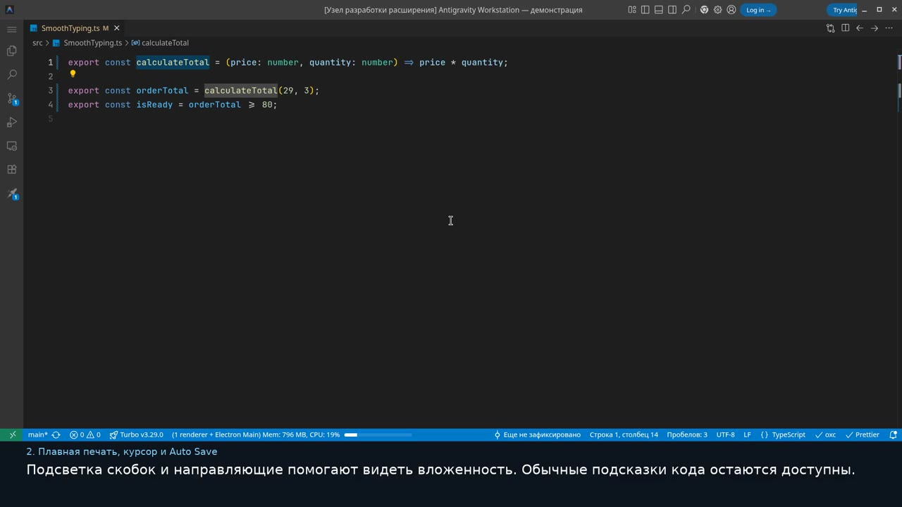

# Видео: Antigravity Workstation 3.0.11 в работе

[Открыть или скачать полное видео MP4](https://github.com/safarovmurod/antigravity-workstation/raw/refs/heads/media-workstation-3.0.11/antigravity-workstation-3.0.11-ru.mp4)

Один подробный ролик с русской озвучкой и английскими примерами кода.

Запись относится к Setup 3.0.11. В **3.0.12** исправлены имена двух настроек import и включение диагностики через `problems.visibility`; актуальные имена и значения приведены в [справочнике настроек](SETTINGS-EXPLAINED.md). Три команды README уже скачивают исправленную версию.

Это запись настоящего Antigravity IDE 2.5.5: видны набор текста, движение курсора, выбор подсказок, команды, клики и прокрутка. Настройки показаны по порядку, включая сравнение до и после; дополнительные короткие ролики для просмотра не нужны.

Полный текстовый справочник: [каждая настройка, её значение и назначение](SETTINGS-EXPLAINED.md).

## Таймкоды

Продолжительность — **29:59**, формат **1920 × 1080, 30 кадров/с**. В MP4 сохранены главы; отдельные короткие ролики открывать не нужно. Для проигрывателя доступны [отдельные русские субтитры SRT](https://github.com/safarovmurod/antigravity-workstation/raw/refs/heads/media-workstation-3.0.11/antigravity-workstation-3.0.11-ru.srt).

| Время | Практическая демонстрация |
|---|---|
| 00:00 | 1. Шрифт JetBrains Mono — до и после |
| 00:35 | 2. Плавная печать, курсор и Auto Save |
| 01:07 | 3. React: rfc, rafce и Emmet |
| 01:44 | 4. Автоимпорт, export и перемещение файлов |
| 02:17 | 5. Отступ 3 пробела, Prettier и сохранение |
| 02:46 | 6. TypeScript и мягкая подсветка ошибок |
| 03:12 | 7. Теги, Tailwind, console log и расширения |
| 03:37 | 8. GitHub: подключение и настоящая панель Git |
| 04:26 | 9. AI Tab и обычные подсказки |
| 04:52 | 9а. Настоящие переключатели AI Tab |
| 05:21 | 10. Rules, skills, MCP и восстановление |

Все страницы полного разбора настроек

| Время | Страница |
|---|---|
| 05:51 | Полный разбор · Как читать полный каталог |
| 06:37 | Полный разбор · Шрифт, тема и удобный рабочий экран · 1/3 |
| 07:07 | Полный разбор · Шрифт, тема и удобный рабочий экран · 2/3 |
| 07:32 | Полный разбор · Шрифт, тема и удобный рабочий экран · 3/3 |
| 07:55 | Полный разбор · Плавный курсор и спокойный набор · 1/2 |
| 08:17 | Полный разбор · Плавный курсор и спокойный набор · 2/2 |
| 08:40 | Полный разбор · Автосохранение, форматирование и три пробела · 1/3 |
| 09:18 | Полный разбор · Автосохранение, форматирование и три пробела · 2/3 |
| 09:51 | Полный разбор · Автосохранение, форматирование и три пробела · 3/3 |
| 10:25 | Полный разбор · Обычные подсказки без AI ghost text · 1/6 |
| 10:59 | Полный разбор · Обычные подсказки без AI ghost text · 2/6 |
| 11:29 | Полный разбор · Обычные подсказки без AI ghost text · 3/6 |
| 11:47 | Полный разбор · Обычные подсказки без AI ghost text · 4/6 |
| 12:06 | Полный разбор · Обычные подсказки без AI ghost text · 5/6 |
| 12:25 | Полный разбор · Обычные подсказки без AI ghost text · 6/6 |
| 12:51 | Полный разбор · Импорт, экспорт и TypeScript · 1/3 |
| 13:29 | Полный разбор · Импорт, экспорт и TypeScript · 2/3 |
| 14:05 | Полный разбор · Импорт, экспорт и TypeScript · 3/3 |
| 14:36 | Полный разбор · React, Emmet, HTML и настройки языков · 1/6 |
| 15:09 | Полный разбор · React, Emmet, HTML и настройки языков · 2/6 |
| 15:33 | Полный разбор · React, Emmet, HTML и настройки языков · 3/6 |
| 16:01 | Полный разбор · React, Emmet, HTML и настройки языков · 4/6 |
| 16:46 | Полный разбор · React, Emmet, HTML и настройки языков · 5/6 |
| 17:30 | Полный разбор · React, Emmet, HTML и настройки языков · 6/6 |
| 18:03 | Полный разбор · CSS, SCSS и Tailwind · 1/2 |
| 18:31 | Полный разбор · CSS, SCSS и Tailwind · 2/2 |
| 18:57 | Полный разбор · Ошибки видны, но не мешают печатать · 1/3 |
| 19:21 | Полный разбор · Ошибки видны, но не мешают печатать · 2/3 |
| 19:49 | Полный разбор · Ошибки видны, но не мешают печатать · 3/3 |
| 20:18 | Полный разбор · Пути, пакеты и вспомогательные подписи · 1/3 |
| 20:47 | Полный разбор · Пути, пакеты и вспомогательные подписи · 2/3 |
| 21:17 | Полный разбор · Пути, пакеты и вспомогательные подписи · 3/3 |
| 21:35 | Полный разбор · Терминал, Git и панель GitHub |
| 22:05 | Полный разбор · Интерфейс, проводник и голосовые команды · 1/2 |
| 22:41 | Полный разбор · Интерфейс, проводник и голосовые команды · 2/2 |
| 23:15 | Полный разбор · Память, наблюдение за файлами и ограничения автоматизации |
| 23:57 | Полный разбор · Старые параметры Jelly Cursor · 1/2 |
| 24:17 | Полный разбор · Старые параметры Jelly Cursor · 2/2 |
| 24:36 | Полный разбор · Все 16 записей клавиатуры · 1/2 |
| 25:35 | Полный разбор · Все 16 записей клавиатуры · 2/2 |
| 26:21 | Полный разбор · Все 26 расширений каталога · 1/4 |
| 27:16 | Полный разбор · Все 26 расширений каталога · 2/4 |
| 27:52 | Полный разбор · Все 26 расширений каталога · 3/4 |
| 28:41 | Полный разбор · Все 26 расширений каталога · 4/4 |
| 29:22 | Полный разбор · Проверка полноты каталога |

## Что показано

| Раздел | На что смотреть |
|---|---|
| Фонт | Настоящий JetBrains Mono 2.304 до и после переключения: различимость `0/O`, `1/l/I`, операторы и лигатуры. В комплекте 16 проверяемых TTF; шрифт выбран для редактора и терминала. |
| Плавный набор | Native smooth caret, плавное мигание, ширина курсора 3 и спокойное отображение при наборе. Плавный курсор работает без эффектов Jelly Cursor. |
| React и HTML | Раскрытие `rfc` и `rafce`, обычное меню подсказок, Emmet через Tab, работа с тегами и путями. |
| Import и export | Экспорт функции в отдельном файле, выбор её подсказки и автоматическое добавление импорта. Английские имена и реальный TypeScript/React-проект. |
| Отступ и форматирование | Отступ 3 пробела, Prettier, явное форматирование через Ctrl+Shift+F и Auto Save после паузы 1 секунда. Настройки проекта `.editorconfig` и `.prettierrc` имеют приоритет; Auto Save не подменяет отдельную проверку форматирования. |
| Ошибки TypeScript | Настоящие ошибки и их исправление. Подчёркивания и Error Lens остаются видимыми при прозрачности 80%; диагностика не отключена. |
| Расширения | Реальный список доступных расширений, их настройки и пользовательские Workstation-панели; отдельно объяснён полный каталог установки. |
| GitHub и Git Branch Panel | Подготовка репозитория, `origin`, текущая ветка, новая ветка, изменения, commit и push через настоящую панель. Вход в GitHub и подключение удалённого репозитория разобраны как инструкция. |
| AI и перезапуск Windows IDE | Обычный IntelliSense сохраняется при отключении AI ghost text. Показаны соответствующие настройки; для native Tab и Windows automation объяснены ожидание закрытия всех окон и полный запуск IDE заново. |
| Rules, skills и MCP | Где находятся управляемые инструкции и файлы, для чего нужны три закреплённых MCP runtime и как проверять их состояние. Наличие конфигурации отделено от успешного живого вызова инструмента. |
| Восстановление ошибки | Исходная ошибка, английская задача для текущего чата и запасные пути: файл, буфер с проверкой и текст в терминале. Completion-only восстановление сохраняет свой узкий scope; критические ошибки остаются остановкой. |
| Полный разбор конфигурации | Все 263 управляемые настройки, 16 записей keybindings и каталог из 26 расширений: 25 обязательных и необязательный Jelly Cursor. |

## Условия записи

Запись сделана в официальном **Antigravity IDE 2.5.5 для Linux x64**, в отдельном тестовом профиле и подготовленном проекте. Применены управляемые настройки Workstation 3.0.11; для читаемости записи отдельно настроены масштаб окна, отключение обновлений и телеметрии. Windows-команды установки не выполнялись в Linux, и Windows native adapter к этому профилю не применялся.

В профиле доступны **24 расширения**, включая Calm TypeScript, Git Branch Panel и пакет Workstation Stability. Загрузка `ms-mssql.mssql` в среде записи заблокирована сетевой политикой, а Jelly Cursor необязателен. Workstation Stability сохранён в профиле, но отключён для изоляции фоновых repair-задач; его наличие не обозначает активную обработку очереди. Поэтому показ полного каталога и объяснение его настроек не означают, что все 26 расширений были установлены и активированы в этой записи.

Демонстрация панели Git использует **локальный origin** в отдельном тестовом репозитории. Commit и push в этом примере настоящие, но выполняются только в локальный репозиторий: личный GitHub-аккаунт не подключался, внешняя публикация не производилась. Шаги реального входа и выбора своего GitHub-репозитория показаны как инструкция, без паролей и токенов.

Настройки MCP, автоматизации и восстановления объясняются по проекту. Запись не доказывает успешный вход в AI, ответ модели, автоматический AI-ремонт или живой вызов каждого MCP. После установки на Windows итог проверяется Doctor и статусом операции; команда отключения подсказок проверяет только completion-настройки.

## Озвучка

Озвучка: **Denis (`ru_RU-denis-medium`, Piper/VITS)**. В карточке модели датасет указан с лицензией **CC0**: [Nabu Casa voice datasets](https://github.com/NabuCasa/voice-datasets). Голос синтезирован локально через [sherpa-onnx](https://github.com/k2-fsa/sherpa-onnx), лицензия движка **Apache-2.0**. Текст не отправлялся в платный голосовой API. [Карточка исходного голоса](https://huggingface.co/rhasspy/piper-voices/tree/main/ru/ru_RU/denis/medium).

Видеофайл хранится в отдельной ветке `media-workstation-3.0.11` этого репозитория. Ветка `main`, её ZIP, npm-пакет и Git-fallback установщика не содержат MP4: три команды настройки не скачивают видео. Полное клонирование всех веток репозитория может получить и медиа-ветку. Для установки по-прежнему используются только [три команды README](../README.md#quick-start).
