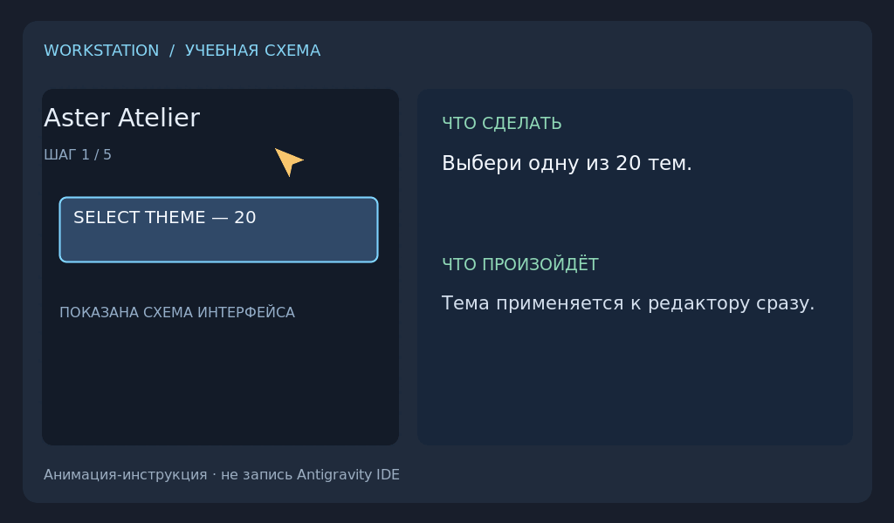

# Aster Atelier

Seventeen editor palettes. Ten bundled programming fonts. One studio that changes nothing until you press **Apply**.

Open **Aster Atelier: Темы и шрифты** from the Command Palette (or the gear menu of this extension).

- **Theme** — pick a palette or Antigravity Light/Dark, then **Применить тему**. Browsing the list never changes the IDE; **Отмена** returns to the applied theme. **Aster Atelier: Выбрать тему** is a quick list that applies only on click or Enter.
- **Font** — family, size, weight and normal/italic are previewed in the panel and applied together with **Применить шрифт**. Italic is applied to all code. The family is set for the editor, terminal, debug console, chat, inlay hints, inline suggestions, notebooks and the commit message box.

Aster palettes are applied over the plain Visual Studio Light/Dark theme as theme-scoped colours, so they are not listed in the IDE's own theme picker (which changes the theme while you hover). Every part of the window is coloured — editor, side bar, panels, tabs, menus, widgets, notifications, terminal, diff, chat and syntax — and every palette keeps text contrast at 4.5:1 or higher. Error Lens messages stay transparent. Colours you set yourself in `workbench.colorCustomizations` keep winning.

All ten fonts ship inside the extension (SIL Open Font License, SHA-256 pinned) and are installed for the current OS user without a download. A newly installed font appears in the editor after a full IDE restart.

## Palettes

**Dark:** Oceanic Pro · Nord Polar · One Dark · Graphite Pro · Slate Night · Pure Black · Crimson Pro · Ocean Wave · Amber Ledger · Orchid Dusk · Evergreen Terminal

**Light:** GitHub Light · Nord Light · Material Light · Horizon Light · Cream Light · Sandstone Studio

## Fonts

JetBrains Mono · Fira Code · Source Code Pro · IBM Plex Mono · Roboto Mono · Space Mono · Inconsolata · Victor Mono · Intel One Mono · Cascadia Code

Fira Code and Inconsolata have no italic face; the renderer slants them. Space Mono has regular and bold weights only.
