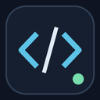

# Calm TypeScript

Ошибки JavaScript и TypeScript видны на строках кода с прозрачностью 80%. Проверка типов и обычные подсказки продолжают работать. Плавный курсор и сохранение после паузы помогают писать код вручную.

Настройки: **Settings → Extensions → Calm TypeScript**. Reset возвращает значения, запомненные при первой активации этого расширения; состояние старого расширения не переносится.

Снимки ниже относятся к предыдущей версии 3.3.0 (95% прозрачности); текущая версия использует 80%.

| До | После (снимок 3.3.0) |
|---|---|
|  |  |

Расширение входит в [Antigravity Workstation](https://github.com/safarovmurod/antigravity-workstation#quick-start).
