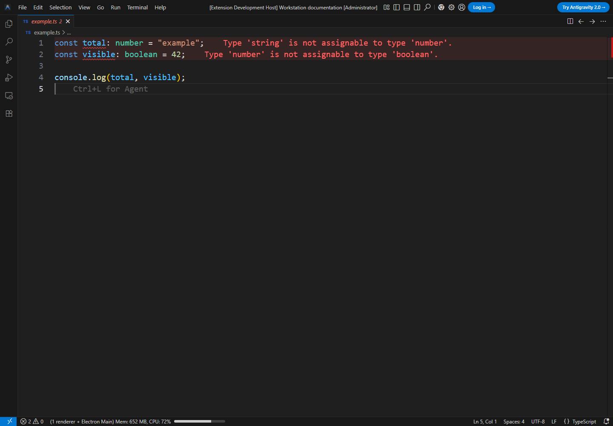
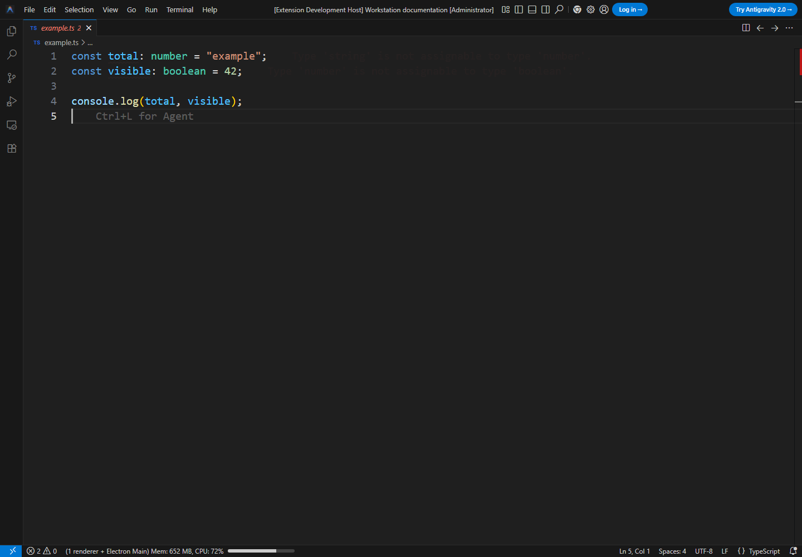

# Calm TypeScript

Ошибки JavaScript и TypeScript видны на строках кода примерно с 85% прозрачности (alpha `26`, около 15% непрозрачности). Проверка типов и обычные подсказки продолжают работать. Курсор плавный; после **Ctrl+S** строка мягко подсвечивается. С версии 3.3.7 расширение само ничего не сохраняет: автосохранение делает IDE (`files.autoSave: afterDelay`, 1 с), поэтому код не переформатируется во время набора.

Настройки: **Settings → Extensions → Calm TypeScript**. Reset возвращает значения, запомненные при первой активации этого расширения; состояние старого расширения не переносится.

Снимки ниже относятся к предыдущей версии 3.3.0 (95% прозрачности); текущая версия использует примерно 85%.

| До | После (снимок 3.3.0) |
|---|---|
|  |  |

Расширение входит в [Antigravity Workstation](https://github.com/safarovmurod/antigravity-workstation#quick-start).
