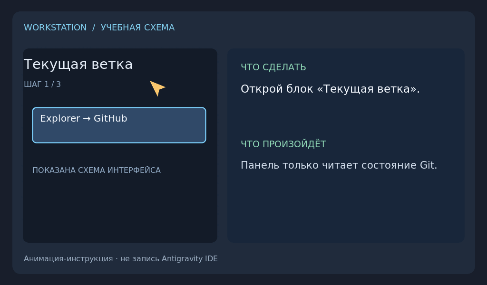
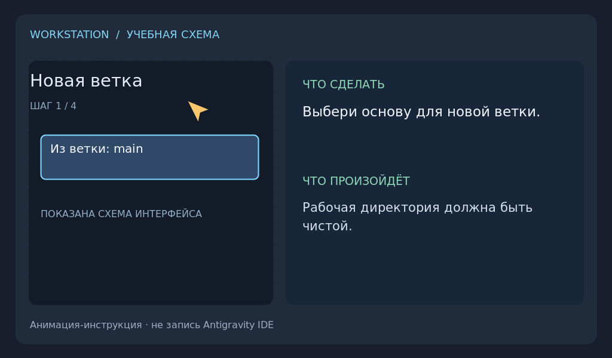
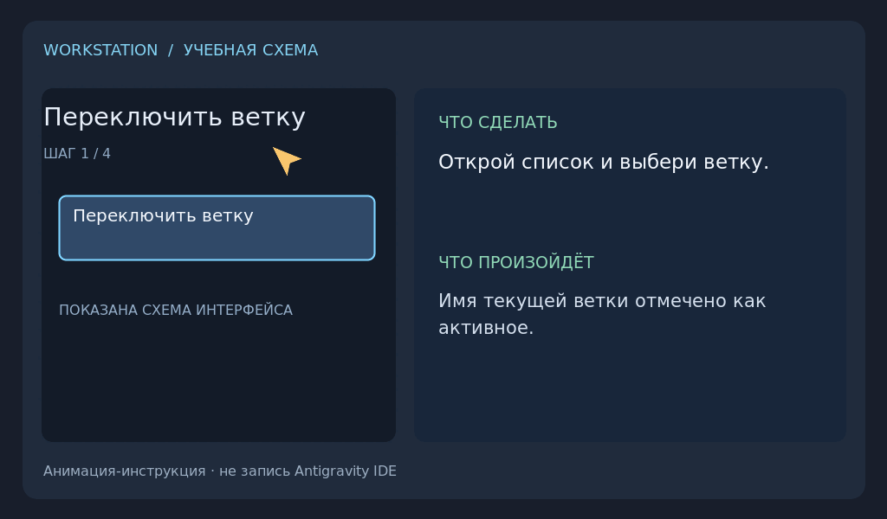
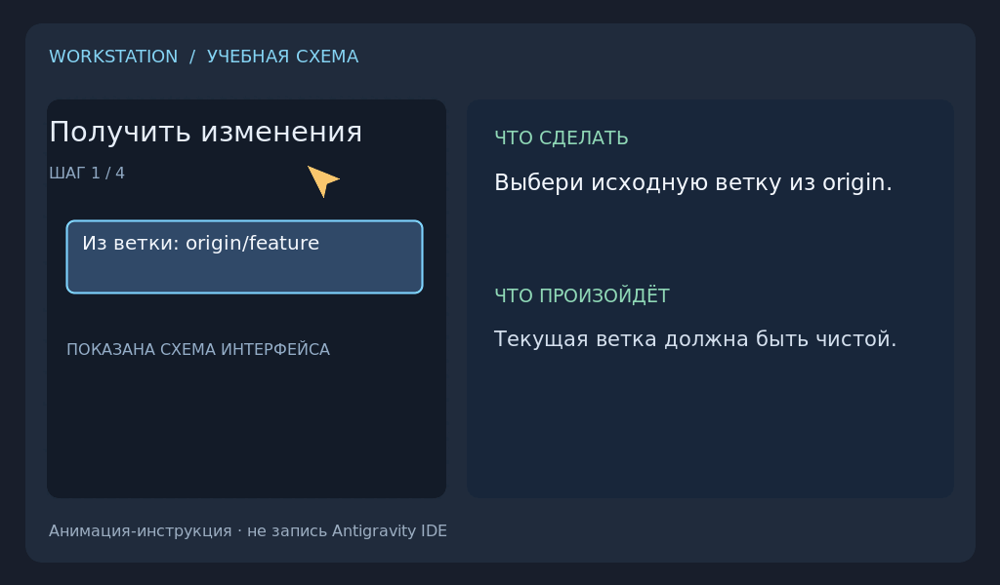
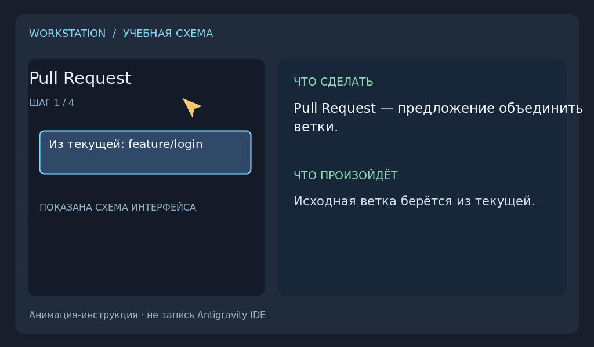
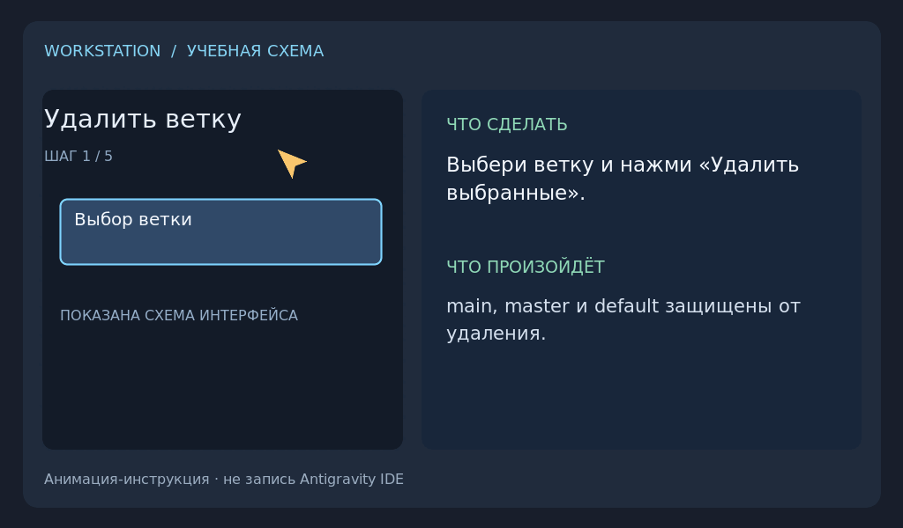

# Git Branch Panel

## Короткие инструкции

Учебные анимации ниже — схемы действий, не запись экрана. Нажми GIF, чтобы скачать MP4.

### 1. Ветка и Commit + Push
Сверху — имя ветки, есть ли изменения и автор commit (твоё имя из `git config --global`). Отметь файлы, напиши сообщение и нажми **Commit и Push**: commit уходит в GitHub под твоим именем. Если в проекте записано чужое имя, панель покажет его и спросит, заменить ли на твоё.

### 2. Новая ветка
Ветка создаётся на компьютере из текущей (или выбранной) ветки и забирает с собой несохранённые в commit изменения. Push не нужен: ветка появится в GitHub с первым **Commit и Push**. Работает и без интернета.

### 3. Переключить ветку
Push перед переключением не нужен. Если изменения мешают переключиться, панель откладывает их и сама возвращает, когда ты вернёшься на эту ветку.

### 4. Получить изменения
Загружает выбранную ветку из GitHub и объединяет её с текущей. При конфликте для каждого файла выбери «Оставить моё» или «Взять из GitHub».

### 6. Pull Request
Открывает в GitHub страницу создания Pull Request из текущей ветки в выбранную. Сама страница ничего не объединяет. Обе ветки должны быть уже в GitHub.

### 5. Удалить ветку
Одно подтверждение удаляет ветку на компьютере и в GitHub, отправлена она или нет. Если в ветке есть commits, которых нет в main, они сначала сохраняются в резервной копии (`refs/workstation-backup/…`). Основную ветку (main) удалить нельзя. Удаление в GitHub защищено: если кто-то успел отправить туда новый commit, он не потеряется.

Панель находится в **Explorer → GitHub** и следует русскому или английскому языку Antigravity. Ошибки Git показываются в панели; если push не удался, commit остаётся на компьютере.

Расширение устанавливается вместе с [Antigravity Workstation](../../README.md).
