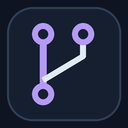

# Git Branch Panel

Панель **Explorer → GitHub**. Работает с тем же `git`, что и Git Bash; вход в GitHub для push — через твой Git Credential Manager. Ошибки показываются так, как их напечатал Git.

### Автор commit
В проекте с GitHub в `git config --local` записывается твой аккаунт GitHub, в который выполнен вход в редакторе: `user.name` = логин, `user.email` = `ID+логин@users.noreply.github.com`. Так личная почта не попадает в GitHub (ошибка GH007). Глобальный `git config` не меняется. Без входа используется владелец репозитория из адреса `origin`, если это пользователь GitHub (публичный профиль `api.github.com/users/<владелец>`). Если владелец — организация или GitHub недоступен, commit идёт с уже настроенными `user.name`/`user.email`, как в Git Bash. Только если их нет, панель просит **Войти в GitHub**.

Если GitHub всё же отклонил push из-за почты в старых commits, кнопка **Исправить автора и отправить** после подтверждения меняет автора только у commits, которых ещё нет в GitHub, и повторяет push.

### Commit
Отметь файлы (по умолчанию отмечены все), напиши сообщение и нажми **Commit**. Commit остаётся на компьютере.

### Push
Отправляет текущую ветку в `origin` под тем же именем. На кнопке видно, сколько commits ждут отправки. Если в GitHub есть новые commits этой ветки, сначала нажми **Получить и объединить**.

### Переключить ветку
Изменения, которые мешают переключению, откладываются и возвращаются, когда ты вернёшься на эту ветку.

### Новая ветка
Создаётся на компьютере из выбранной ветки и забирает с собой изменения без commit.

### Получить изменения
Загружает выбранную ветку из GitHub и объединяет с текущей. При конфликте выбери для каждого файла «Моё» или «Из GitHub» либо отмени merge.

### Удалить ветку
Удаляет ветку на компьютере и в GitHub после одного подтверждения. Commits, которых нет в основной ветке, сначала сохраняются в `refs/workstation-backup/…`. Основную ветку удалить нельзя.

Панель обновляется сама после правок файлов, commits и переключений веток, в том числе сделанных в терминале. Расширение устанавливается вместе с [Antigravity Workstation](../../README.md).
